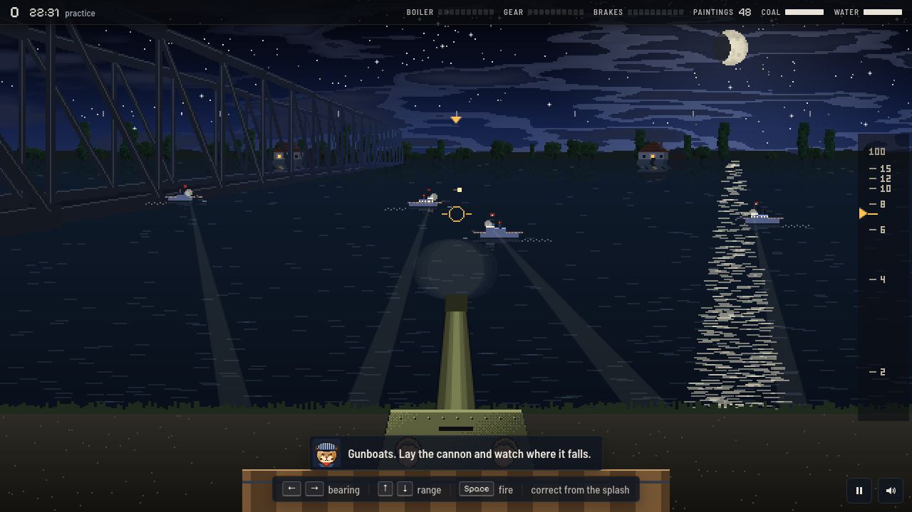

# The Puma Express

**One night, one train, forty-eight paintings.** A remake of *The Train: Escape to Normandy* (Accolade, 1987, Commodore 64), redrawn as modern pixel art. The Resistance are pumas and the occupiers are the Wolf Empire.

The wolves have stripped the puma country's galleries and loaded the pictures on a train in the yards at Velmont. Take the train and run it west across occupied country to Port Clair, on the free coast, before dawn. You drive the steam engine by hand from the cab: keep the fire fed and the pressure up, work the throttle, the reverser and the brake, and whistle to set the points at each junction. Wolves holding a station stop the train, and you cover Duc up the platform to the points lever and back. Gunboats wait at the bridges, where you lay the cannon by bearing and range, and fighters come down the line to meet the two anti-aircraft guns. At each station of ours there is coal, water, Duc's report, and one message by telegraph. There are three difficulties and the map is the same every night, but who holds which stations, which bridges are watched and where the line is cut change from night to night.

**Classic** plays as the 1987 game did. **Field**, the default, adds a fireman, a lookout, the route on the map, mouse and keys on the controls and other aids, each of which can be switched on or off.




## Play it online

[greykit.com/games/pumaexpress](https://greykit.com/games/pumaexpress/)

## Play it on your own computer

The Puma Express is a web page. There is nothing to install and nothing to build, and once you have a copy it needs no internet connection: every picture is drawn and every sound synthesised in the page, and its two typefaces come with it.

1. **Download it.** On GitLab, use **Code → Download source code → zip**, or clone it:

   ```bash
   git clone https://gitlab.com/greykit-app/games/pumaexpress.git
   ```

2. **Unzip it**, if you downloaded the zip.
3. **Open `index.html`** in a desktop browser. Double-clicking it usually does it.

### What you need

- A **desktop or laptop** with a **keyboard**. A gamepad works too.
- A recent Chrome, Edge, Firefox or Safari.
- A browser window at least **760 × 480**. On a phone or a smaller window, the page shows a note instead of the game.
- Sound is optional: `M` turns it on and off.

The keys are listed in the game under **Help** (`?` on the title screen).

### If it doesn't start

Some browsers are strict about pages opened straight from disk. If you see a blank screen, or your high scores aren't remembered, serve the folder instead. From inside the game's folder:

```bash
python3 -m http.server 8000
```

Then open <http://localhost:8000>. Any static file server does the same job.

## Put it on your own website

The game is static files. Copy them to any web host that serves files, such as an ordinary web server, GitLab Pages, GitHub Pages or Netlify, and open the folder's address. It works at the site root or in any subfolder, because every path in it is relative.

**Upload these:**

| | |
|---|---|
| `index.html` | the page |
| `css/`, `js/`, `fonts/` | the game, its styles and its two typefaces (keep the font licence files with them) |
| `manifest.webmanifest`, `icon.svg`, `favicon.ico`, `favicon-16x16.png`, `favicon-32x32.png`, `apple-touch-icon.png` | the icons, and the manifest that lets a browser install it as an app |
| `og.png` | the picture shown when the link is shared |
| `LICENSE` | the MIT licence, which asks that it travel with copies |

**Leave out** `screenshots/`, `tools/`, the Markdown files, and anything starting with a dot (`.git`, `.gitlab-ci.yml` and so on). The game never loads them.

**Two things to change for your own address:**

- **Link previews.** The `og:image`, `og:url` and `twitter:image` tags near the top of `index.html` point at greykit.com. Change them to your own address, or a shared link will show greykit.com's card.
- **Caching.** Every script and stylesheet URL in `index.html` ends in `?v=` and a hash of the file. So a host or CDN can cache `css/` and `js/` for as long as it likes, as long as `index.html` itself isn't cached for long.

## Your saves

- The high scores, a night in progress, your settings and the sound setting are kept **in your browser**, not in the game's folder.
- Another browser, the online version, or a different address (a different `localhost` port, say) each keep their own separate saves.
- Everything is stored under keys beginning `pumaexpress_`, so it won't collide with other pages on the same site.
- **Settings → Forget everything** erases all of it. It asks first.

## Credits

*The Train: Escape to Normandy* was developed by Artech and published by Accolade in 1987, loosely after the 1964 film *The Train*. The Puma Express is not affiliated with Accolade or Artech, and none of the original's code, art, sound or text is used. Everything here is drawn and synthesised in the page, the title tune included. The line, the towns and the numbers are new; the shape of the night is 1987's.

Typefaces: [Barlow Semi Condensed](https://fonts.google.com/specimen/Barlow+Semi+Condensed) and [Pixelify Sans](https://fonts.google.com/specimen/Pixelify+Sans), under the SIL Open Font License.

Built by [greykit.com](https://greykit.com/).

## License

MIT. See [LICENSE](LICENSE).
