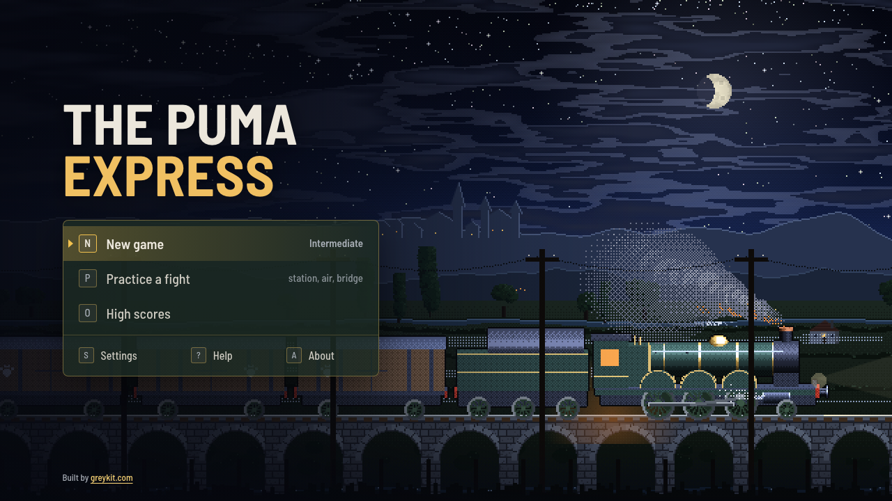
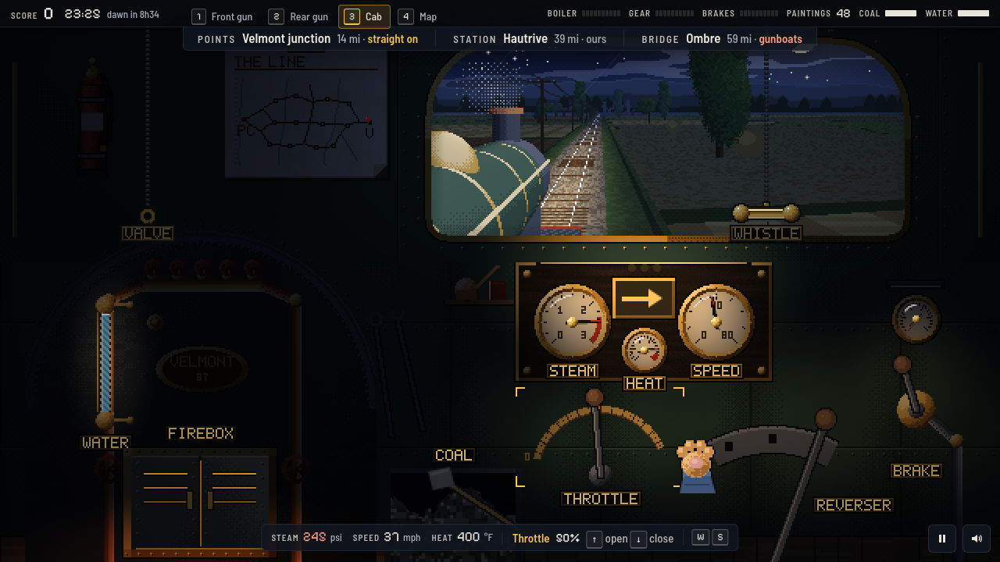
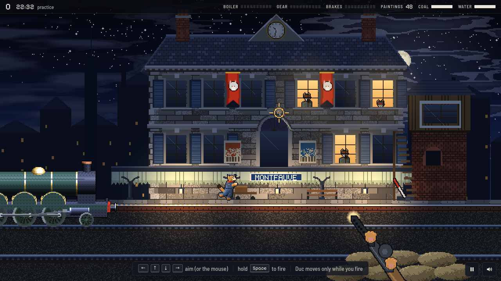

# The Puma Express

**One night, one train, forty-eight paintings.** A remake of *The Train: Escape to Normandy* (Accolade, 1987, Commodore 64), redrawn as modern pixel art. The Resistance are pumas and the occupiers are the Wolf Empire.

**Play:** [greykit.com/games/pumaexpress](https://greykit.com/games/pumaexpress/)

## How it plays

The wolves have loaded the puma country's paintings on a train in the yards at Velmont. Take it and run it west across occupied country to Port Clair before dawn. You drive the steam engine by hand from the cab: feed the fire, keep the pressure up, work the throttle, reverser and brake, and whistle to set the points at each junction. Wolves holding a station stop the train while you cover Duc to the points lever and back; gunboats wait at the bridges and fighters come down the line. Stations of ours give coal, water, a report and one telegraph message. The map is the same every night; who holds what, and where the line is cut, is not. Three difficulties.

**Classic** plays as the 1987 game did. **Field**, the default, adds a fireman, a lookout, the route on the map, mouse and keys on the controls and other aids, each of which can be switched on or off.

## Keys

A desktop game for keyboard or gamepad, in a window at least 760 × 480. `?` on the title screen lists every key; `M` is sound.

## Saves

Kept in the browser's `localStorage` under keys starting `pumaexpress_`. **Settings → Forget everything** clears them.

## Credits

*The Train: Escape to Normandy* was developed by Artech and published by Accolade in 1987, loosely after the 1964 film *The Train*. The Puma Express is not affiliated with Accolade or Artech, and none of the original's code, art, sound or text is used. Everything here is drawn and synthesised in the page, the title tune included. The line, the towns and the numbers are new; the shape of the night is 1987's.

Typefaces: [Barlow Semi Condensed](https://fonts.google.com/specimen/Barlow+Semi+Condensed) and [Pixelify Sans](https://fonts.google.com/specimen/Pixelify+Sans), under the SIL Open Font License.

Working on the game: [DEVELOPMENT.md](DEVELOPMENT.md).

By Matthew "Shan" Romanek, with Claude. Built by [greykit.com](https://greykit.com/).

Made for my own play. Nothing here is offered: no support, no updates, no licence.
